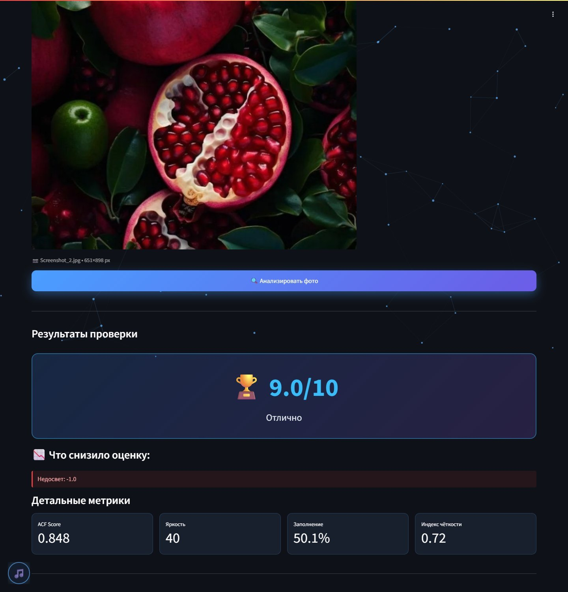
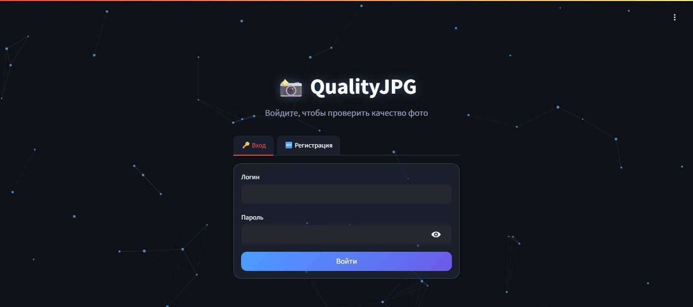
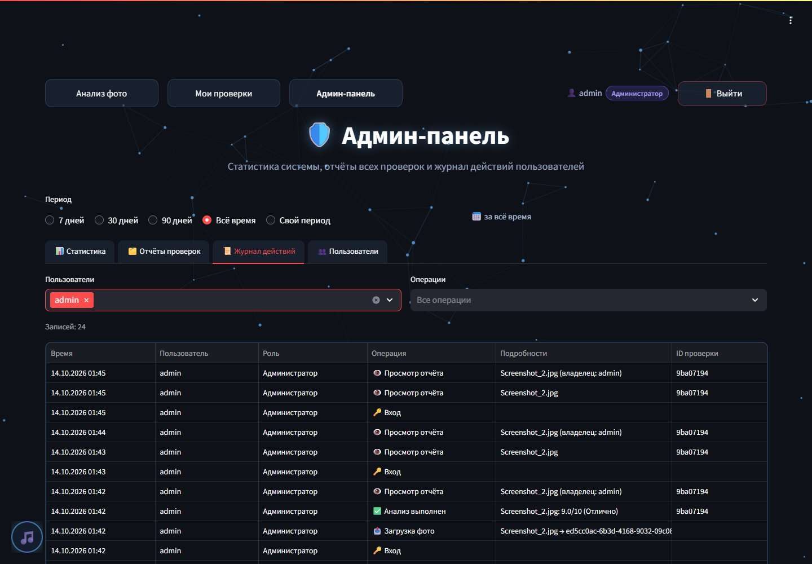
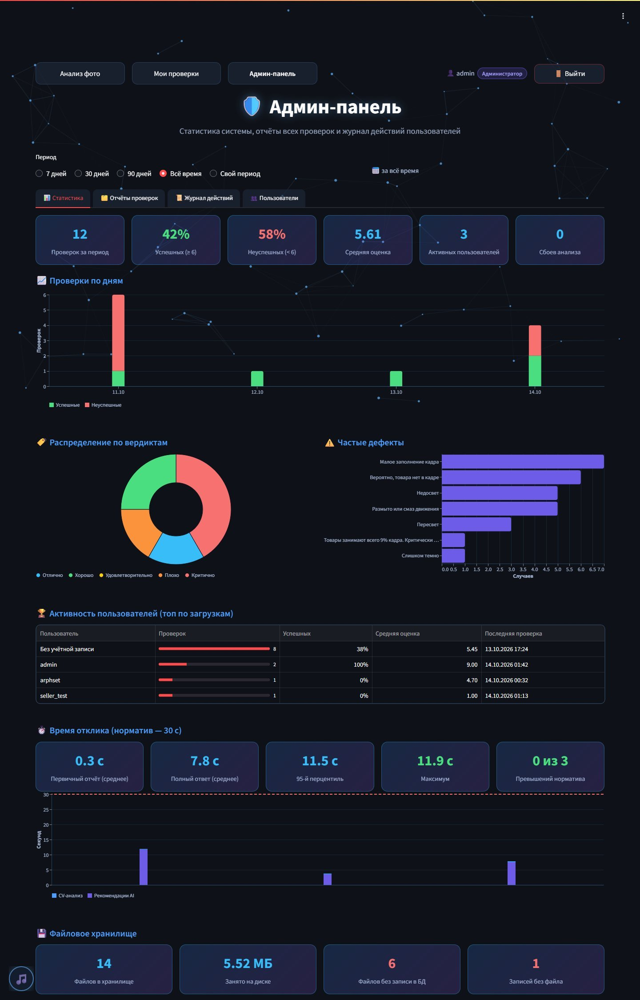
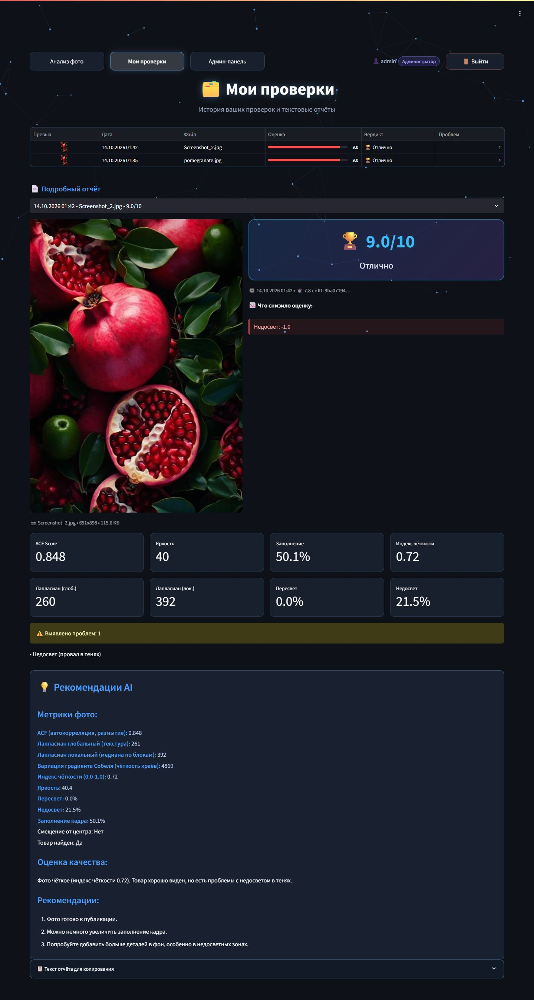
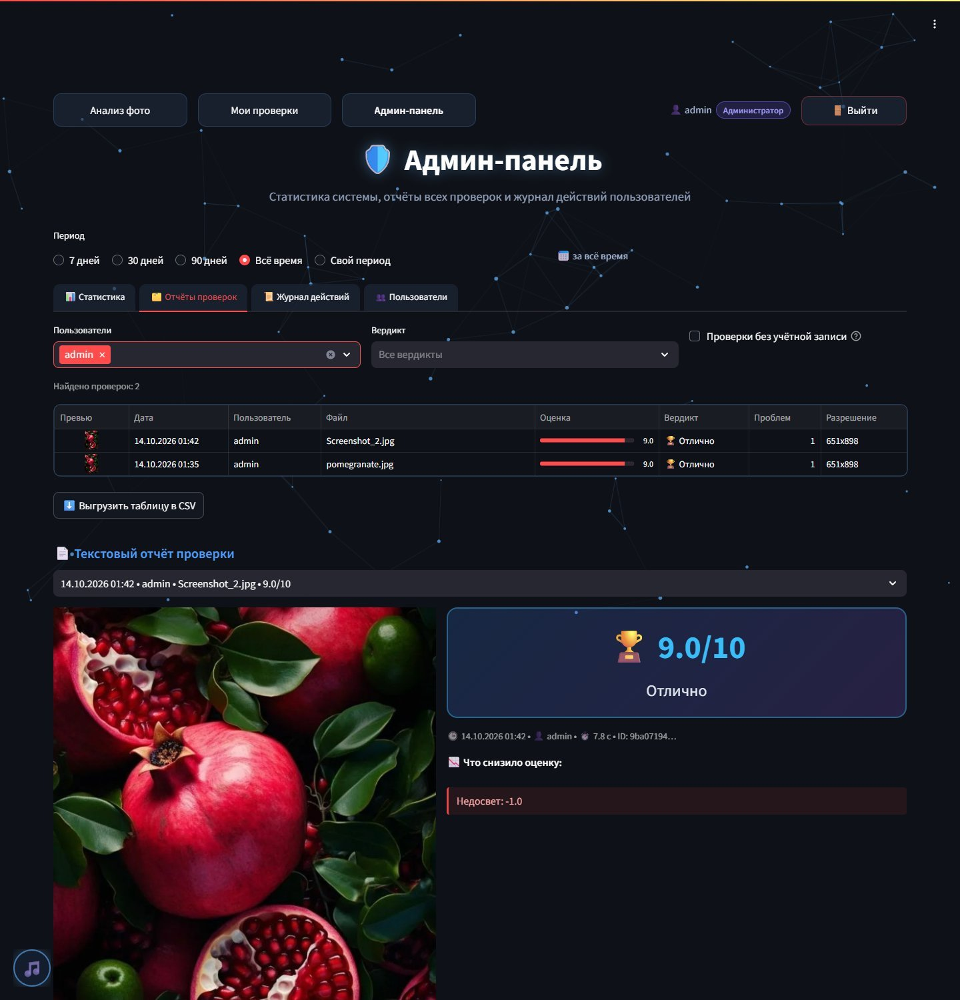

<div align="center">

# 📸 QualityJPG

**AI-анализ качества фото товаров для маркетплейсов**

Проверьте фото до публикации: оценка из 10, список дефектов и советы по исправлению — за секунды.

[](https://www.python.org/)
[](https://streamlit.io/)
[](https://opencv.org/)
[](https://docs.ultralytics.com/)
[](https://ollama.com/)
[](https://www.postgresql.org/)
[](https://docs.docker.com/compose/)
[](docs/TEST_REPORT.md)
[](docs/TEST_REPORT.md#2-время-отклика-задача-71-r0101)



</div>

---

Информационная система «QualityJPG» автоматически проверяет фотографии товаров перед публикацией:
оценивает резкость, экспозицию и композицию алгоритмами компьютерного зрения, выставляет оценку
по 10-балльной шкале и формирует текстовые рекомендации с помощью локальной LLM (Ollama).
Все данные остаются на вашем сервере — фото не уходят во внешние облачные API.

Учебный проект по дисциплине «Технологии создания и поддержки ПО» (ПИ21/1, Ерёмин Аким).

## Что именно оценивает QualityJPG

QualityJPG отвечает на практический вопрос: **готово ли фото для карточки товара на маркетплейсе?**
Художественную ценность система не оценивает, и это сознательное решение: красивое фото и хорошее
фото для продаж — разные вещи. Минималистичный кадр с крошечным парусником в море может быть
эстетичным, но покупатель не разглядит на нём товар, поэтому система справедливо снизит оценку.

Каждая оценка **объяснима**: отчёт показывает не просто «6/10», а конкретные причины —
«Недосвет −1.0», «Заполнение кадра 9% −2.5» — и рекомендации, как это исправить.
Продавец видит, за что снижен балл, и сам решает, применять ли совет.

**Где оценку стоит перепроверить.** Метрики измеряют физические свойства изображения
(перепады яркости, гистограмму, долю кадра под объектом) и не знают о замысле автора:
- **художественные приёмы** — боке, намеренно тёмный («low-key») или светлый («high-key») кадр,
  осознанная асимметрия. Часть из них система уже учитывает: резкость считается только по области
  товара, а пороги экспозиции подстраиваются под тёмные и светлые фото;
- **редкие категории товаров** — детектор YOLOv8 обучен на 80 классах COCO, поэтому, например,
  косметику или украшения он может не распознать как товар;
- **разные стили съёмки** — пороги общие для предметной съёмки на белом фоне и lifestyle-фото.

QualityJPG — помощник, а не судья: надёжно находит технический брак (смаз, пересвет, товар
в углу кадра), а финальное решение остаётся за человеком. Направления развития — в разделе
[«Развитие проекта»](#развитие-проекта).

## Как это работает

1. **Загрузите фото** (JPG/PNG до 10 МБ) — файл сохраняется в хранилище под уникальным UUID.
2. **Компьютерное зрение** за 0,2–3 с оценивает резкость (ACF, лапласиан, градиент Собеля),
   экспозицию (пересвет и недосвет по гистограмме) и композицию (YOLOv8 находит товар и считает заполнение кадра).
3. **Оценка из 10 и список дефектов** появляются сразу.
4. **Локальная LLM** (Ollama, qwen2.5:3b) пишет рекомендации — текст появляется на странице по мере генерации.
5. Результат сохраняется в истории; администратор видит статистику по всей системе.

## Скриншоты

<table>
  <tr>
    <td width="50%"><br><sub><b>Вход и регистрация</b> — доступ только после авторизации</sub></td>
    <td width="50%"><br><sub><b>Журнал действий</b> — входы, загрузки, анализы, отказы в доступе</sub></td>
  </tr>
  <tr>
    <td><br><sub><b>Админ-панель: статистика</b> — проверки по дням, вердикты, частые дефекты, топ пользователей, время отклика</sub></td>
    <td><br><sub><b>Мои проверки</b> — история с полным отчётом и рекомендациями AI</sub></td>
  </tr>
  <tr>
    <td colspan="2"><br><sub><b>Отчёты всех проверок</b> — фильтры по пользователю и вердикту, выгрузка в CSV, просмотр любого отчёта</sub></td>
  </tr>
</table>

## Возможности

| Роль | Функции |
|---|---|
| **Продавец** | Регистрация и вход · загрузка JPG/PNG до 10 МБ · оценка качества и список дефектов · рекомендации AI (потоковый вывод) · копирование отчёта (текст / JSON) · история своих проверок |
| **Администратор** | Всё, что у продавца (F.03.02) · статистика за период (число проверок, % успешных/неуспешных, активность пользователей, частые дефекты, время отклика) · отчёты всех проверок с фильтрами и выгрузкой в CSV · журнал действий пользователей · список пользователей |

## Архитектура

```
Web-Client (браузер)
      │ HTTP / WebSocket
Web-server (Streamlit, frontend/)
      ├── I_ML_ANALYSIS  → ML&CV_Module/ (OpenCV + YOLOv8 + Ollama qwen2.5:3b)
      ├── I_DATA_ACCESS  → database/ (PostgreSQL 16, psycopg2)
      └── I_FILE_STORAGE → frontend/uploads/ (файлы под UUID, связь с БД по storage_filename)
```

Соответствует диаграмме компонентов из ТЗ. Сценарии работы — диаграммы последовательностей
«Загрузка и анализ фото» и «Просмотр статистики».

### Технологии
Python 3.11 · Streamlit 1.41 · OpenCV · Ultralytics YOLOv8n · Ollama (OpenAI-совместимый API) ·
PostgreSQL 16 · Altair · Docker Compose.

## Запуск

Требования: Docker Desktop и [Ollama](https://ollama.com) на хост-машине с моделью `qwen2.5:3b`:

```bash
ollama pull qwen2.5:3b
```

```bash
docker compose up -d --build
```

Приложение: <http://localhost:8501>. При первом запуске создаётся администратор из переменных
`ADMIN_LOGIN` / `ADMIN_PASSWORD` (по умолчанию `admin` / `admin12345` — **смените перед эксплуатацией**,
например через файл `.env` рядом с `docker-compose.yml`). Продавцы регистрируются сами.

После изменения Python-кода перезапустите приложение: `docker restart qualityjpg_app`.

### Переменные окружения (сервис `app`)

| Переменная | Назначение | По умолчанию |
|---|---|---|
| `DATABASE_URL` | Подключение к PostgreSQL | см. docker-compose.yml |
| `OLLAMA_HOST` / `OLLAMA_MODEL` | Адрес и модель Ollama | `http://host.docker.internal:11434` / `qwen2.5:3b` |
| `OLLAMA_TIMEOUT`, `OLLAMA_MAX_TOKENS`, `OLLAMA_KEEP_ALIVE` | Таймаут, длина ответа, время удержания модели в памяти | `60`, `350`, `60m` |
| `YOLO_WEIGHTS` | Путь к весам YOLO | `/app/frontend/yolov8n.pt` |
| `ADMIN_LOGIN` / `ADMIN_PASSWORD` | Учётная запись администратора | `admin` / `admin12345` |
| `APP_TIMEZONE` | Часовой пояс статистики | `Europe/Moscow` |

## Структура проекта

```
frontend/
  app.py              точка входа: тема, миграции, вход, навигация по ролям
  views/analyze.py    загрузка и анализ фото
  views/history.py    «Мои проверки»
  views/admin.py      админ-панель
  auth.py             аутентификация, журнал действий
  theme.py            общий дизайн (фон, музыка, CSS)
  report_view.py      отображение отчёта
  storage.py          файловое хранилище
ML&CV_Module/
  main.py             analyze_image()
  filters/            резкость, яркость, YOLO, расчёт оценки
  ollama/             рекомендации LLM (потоковый вывод)
database/
  init.sql, migrations/   схема БД (миграции идемпотентны, применяются при старте)
  repository.py       доступ к данным, статистика
  security.py         хэширование паролей (PBKDF2-SHA256)
tests/                модульные, интеграционные и UI-тесты, замер времени отклика
docs/                 руководство пользователя, протокол испытаний
```

## Тестирование

```bash
docker exec qualityjpg_app python tests/run_tests.py    # 43 теста, протокол → tests/results/
docker exec qualityjpg_app python tests/benchmark.py    # замер времени отклика (R.01.01)
```

Тесты используют отдельную БД `qualityjpg_test` и временную папку хранилища — рабочие данные не затрагиваются.
Результаты: [docs/TEST_REPORT.md](docs/TEST_REPORT.md).

## Соответствие требованиям ТЗ

| ID | Требование | Реализация |
|---|---|---|
| F.01.01 | Загрузка файла JPG/PNG | `views/analyze.py`: загрузчик, проверка формата, размера ≤ 10 МБ и целостности |
| F.01.02 | Автоматический анализ | `ML&CV_Module/main.py`: ACF, лапласиан, Собель, гистограмма, YOLOv8 |
| F.01.03 | Текстовый отчёт на странице | Карточка оценки, штрафы, метрики, список дефектов |
| F.02.01 | Список проблем | `issues` из анализа, частые дефекты в админке |
| F.02.02 | Советы по устранению | Ollama `qwen2.5:3b`, потоковый вывод |
| F.02.03 | Копирование советов | Блоки «Текст» / «JSON» с кнопкой копирования |
| F.03.01 | Статистика и отчёты всех проверок | `views/admin.py` |
| F.03.02 | Наследование прав | Администратору доступны страницы продавца |
| R.01.01 | Отклик ≤ 30 с для файлов до 10 МБ | Среднее 12,0 с, максимум 20,1 с; первичный отчёт ≤ 3 с; предупреждение при превышении |
| R.01.03 | Обработка ошибок ML | Сбой анализа или Ollama → понятное сообщение, приложение не падает |
| S.01.01 | Аутентификация | Логин/пароль, хэш PBKDF2, уникальные логины |
| S.01.02 | Разграничение прав | Админка не регистрируется для продавца + серверная проверка роли (403) |
| S.01.03 | Приватность фото | История только своя; файлы читаются сервером после проверки прав, статическая раздача отключена |
| U.01.01–03 | Интерфейс | Кнопка загрузки и индикатор прогресса · экраны от 1366×768 · русский язык |
| A.01.01–02 | Клиент-сервер, ML/CV-модуль | Streamlit + отдельный модуль `ML&CV_Module` |
| D.01.01–02 | БД и файловое хранилище | PostgreSQL + `frontend/uploads` (UUID) |

## Известные ограничения

- Сессия хранится в памяти Streamlit: после обновления страницы (F5) нужно войти снова.
- Время ответа зависит от CPU хоста: Ollama работает без GPU.

## Развитие проекта

- Замер точности на размеченной выборке: доля совпадений вердикта системы с оценкой эксперта.
- Кнопка «оценка неверна» в отчёте — сбор обратной связи для подстройки порогов.
- Режимы проверки «каталог (белый фон)» и «lifestyle» со своими порогами.
- Визуальная LLM (например, qwen2.5-vl через Ollama) для смыслового анализа: распознать
  намеренно тёмный кадр или товар редкой категории.
- Отдельная модель эстетики (NIMA, LAION Aesthetic Predictor) — как дополнительная оценка
  рядом с технической.
